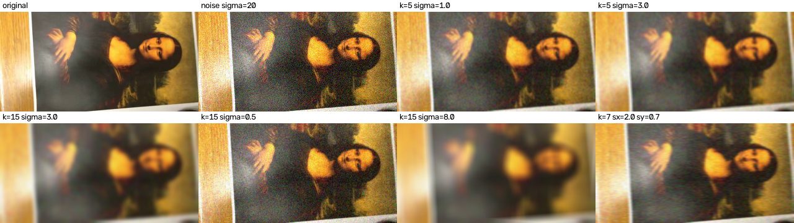
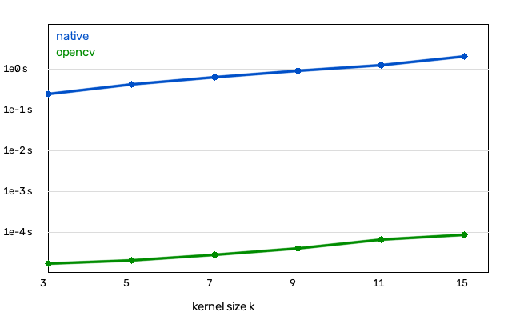
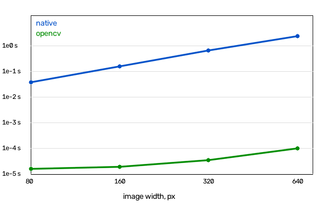

# ЛР1. Фильтр Гаусса с переменным размером ядра

СКОИС, вариант 3. Степаненко В.П., P3432.

Цель работы: научиться реализовывать простые алгоритмы обработки изображений. В варианте 3 это усредняющий фильтр Гаусса, у которого размер ядра и параметры гауссианы задаёт пользователь. Фильтр сделан двумя способами: на чистом Python и через `cv2.GaussianBlur` из OpenCV. Дальше сравнивается результат и скорость.

## 1. Теоретическая база

Фильтр Гаусса относится к линейным пространственным фильтрам: новое значение пикселя считается как взвешенная сумма его окрестности. Веса берутся из двумерной гауссианы

$$G(x, y) = \frac{1}{2\pi\sigma_x\sigma_y}\exp\left(-\frac{x^2}{2\sigma_x^2} - \frac{y^2}{2\sigma_y^2}\right)$$

Параметры $\sigma_x$ и $\sigma_y$ задают степень размытия по горизонтали и вертикали. Чем больше сигма, тем шире колокол и тем сильнее сглаживание. Ядро размера $k \times k$ ($k$ нечётное) обрезает бесконечную гауссиану, поэтому веса нормируют, чтобы их сумма была равна единице и яркость не менялась:

$$w_{ij} = \frac{G(i, j)}{\sum_{a,b} G(a, b)}, \qquad I'(x, y) = \sum_{i=-r}^{r}\sum_{j=-r}^{r} w_{ij}\, I(x+i,\, y+j), \quad r = \frac{k-1}{2}$$

Размер ядра и сигма связаны. Практически весь вес лежит в пределах $3\sigma$ от центра, так что при $k > 6\sigma + 1$ лишние края ядра почти нулевые, а при слишком маленьком $k$ гауссиана обрезается и фильтр ближе к обычному усреднению.

Например, для $k = 3$, $\sigma = 1$ ядро выглядит так:

| 0.0751 | 0.1238 | 0.0751 |
|--------|--------|--------|
| 0.1238 | 0.2042 | 0.1238 |
| 0.0751 | 0.1238 | 0.0751 |

Гауссиана раскладывается в произведение двух одномерных, поэтому двумерную свёртку можно заменить двумя одномерными проходами. Стоимость на пиксель падает с $k^2$ до $2k$. Этим пользуются библиотечные реализации.

На краях изображения окрестность выходит за границы. Использовано отражение без повтора крайней строки (`BORDER_REFLECT_101` в OpenCV), чтобы обе реализации считали граничные пиксели одинаково.

## 2. Описание разработанной системы

Всё в двух файлах.

- `gauss.py`: сами фильтры и консольный запуск.
- `bench.py`: сравнение результатов, замеры времени, картинки для отчёта.

Функции в `gauss.py`:

- `kernel(k, sx, sy)` строит нормированное ядро. Одномерные векторы по x и по y перемножаются, потому что гауссиана разделима.
- `blur_native(img, k, sx, sy)` собственная реализация. Каждый канал переводится в списки Python, края дополняются отражением, затем для каждого пикселя считается сумма по окну $k \times k$. Это прямая двумерная свёртка, без использования разделимости, чтобы реализация честно соответствовала формуле. Строку ядра на строку окна перемножает `sum(map(mul, ...))`, чтобы внутренний цикл не писать на Python. NumPy в самом фильтре не используется, только для упаковки результата в массив.
- `blur_cv(img, k, sx, sy)` вызов `cv2.GaussianBlur`.

Запуск:

```
pip install opencv-python numpy
python gauss.py data/input.png out.png -k 7 -s 2.0 --impl native
python gauss.py data/input.png out.png -k 7 -s 2.0 --sigma-y 0.7 --impl cv
python bench.py
```

Параметры: `-k` размер ядра (нечётное, от 3), `-s` сигма по x, `--sigma-y` сигма по y (если не указана, равна сигме по x), `--impl` реализация. Для проверки использовался Python 3.14 и OpenCV 5.0.

Тестовое изображение `data/input.png` 320x180: кадр из `mona-lisa.avi` из архива `test-videos.zip`, выданного по курсу. Шум для проверки добавляется в `bench.py`: нормальный, сигма 20, фиксированное зерно генератора, поэтому результаты повторяются.

## 3. Результаты работы и тестирование

Полный вывод `bench.py` лежит в `results/bench.txt`.

### Совпадение двух реализаций

Фильтры применялись к зашумлённому кадру с разными параметрами.

| k | sigma | max \|diff\| | mean \|diff\| | PSNR к исходнику, дБ |
|---|-------|-------------|--------------|----------------------|
| 3 | 0.8 | 1 | 0.0266 | 29.02 |
| 5 | 1.0 | 1 | 0.0589 | 29.32 |
| 5 | 3.0 | 1 | 0.0560 | 27.47 |
| 9 | 2.0 | 1 | 0.0240 | 26.34 |
| 15 | 3.0 | 1 | 0.0621 | 23.80 |
| 15 | 0.5 | 1 | 0.0662 | 26.02 |

Зашумлённое изображение без фильтра даёт 22.38 дБ. Разница между своей реализацией и OpenCV не больше одного уровня яркости, в среднем сотые доли. Причина в округлении: OpenCV на 8-битных данных считает в целых числах с фиксированной точкой, моя версия во float. Случай с разными сигмами (k=7, sx=2.0, sy=0.7) тоже расходится максимум на 1.

### Влияние параметров



Верхний ряд: исходный кадр, зашумлённый, затем k=5 sigma=1 и k=5 sigma=3. Нижний: k=15 sigma=3, k=15 sigma=0.5, k=15 sigma=8, k=7 с разными сигмами по осям (2.0 по x, 0.7 по y).

Закономерности:

- При фиксированном k главную роль играет сигма. При k=15 и sigma=0.5 сглаживание слабое: окно большое, но все веса кроме ближайших к центру ничтожны. При k=5 sigma=3 размытие сильнее, чем при k=5 sigma=1, хотя окно то же.
- Из проверенных вариантов лучшая метрика у k=5, sigma=1 (29.32 дБ). Дальше размытие убирает шум, но сглаживает и детали, PSNR падает: при k=15 sigma=3 он 23.80 дБ, лишь немного выше, чем у зашумлённого кадра (22.38).
- Ядро с sigma=8 при k=15 близко к равномерному усреднению: гауссиана в окне почти плоская.
- Разные сигмы по осям дают направленное размытие. При sx=2.0 и sy=0.7 размытие по горизонтали сильнее, чем по вертикали.

### Быстродействие

Замеры на AMD Ryzen 7 5700X, 320x180, цветное изображение, sigma = k/5. У своей реализации лучшее из двух запусков, у OpenCV лучшее из 200. Для OpenCV это время одного вызова на прогретом кэше, к тому же он может распараллеливать работу по потокам, так что цифра показывает порядок величины, а не точную стоимость фильтра.

| k | своя, с | OpenCV, с | во сколько раз |
|---|---------|-----------|----------------|
| 3 | 0.249 | 0.000017 | 14457 |
| 5 | 0.412 | 0.000021 | 20010 |
| 7 | 0.631 | 0.000029 | 21696 |
| 9 | 0.907 | 0.000041 | 21970 |
| 11 | 1.242 | 0.000069 | 18081 |
| 15 | 2.046 | 0.000090 | 22834 |



Зависимость от размера изображения при k=7, sigma=1.4:

| размер | своя, с | OpenCV, с | во сколько раз |
|--------|---------|-----------|----------------|
| 80x45 | 0.039 | 0.000016 | 2501 |
| 160x90 | 0.158 | 0.000019 | 8284 |
| 320x180 | 0.654 | 0.000036 | 18410 |
| 640x360 | 2.461 | 0.000100 | 24561 |



Своя реализация растёт линейно с числом пикселей: площадь выросла в 4 раза, время тоже примерно в 4 (0.158 до 0.654 с). От размера ядра зависимость слабее квадратичной: от k=3 до k=15 число операций на пиксель выросло в 25 раз, а время только в 8. Постоянная часть (дополнение краёв, цикл по пикселям) в Python велика, а внутреннюю сумму по строке ядра выполняет `map` на уровне C. У OpenCV время для маленьких изображений почти не меняется, на 80x45 оно упирается в накладные расходы вызова.

## 4. Выводы

- Фильтр Гаусса с переменными размером ядра и сигмой реализован двумя способами. Результаты совпадают с точностью до одного уровня яркости из-за разной арифметики округления.
- Параметры нужно подбирать вместе: сигма определяет степень размытия, размер ядра должен покрывать порядка $3\sigma$ в каждую сторону. Увеличение k без роста сигмы ничего не даёт, а слишком большая сигма при малом ядре превращает фильтр в простое усреднение.
- На шуме с сигмой 20 из проверенных лучше всего сработали небольшие параметры (k=5, sigma=1, 29.32 дБ). Более сильное сглаживание теряет детали быстрее, чем убирает шум.
- OpenCV быстрее чистого Python в 14 тысяч раз и больше. Он использует разделимость гауссианы, векторные инструкции и компилированный код, а у собственной версии прямая двумерная свёртка и интерпретатор. В замерах смешаны алгоритм и среда выполнения, поэтому разрыв нельзя целиком списать на алгоритм. Отдельно версию с разделимостью на Python я не мерил.
- Практический вывод: на Python собственная реализация годится для учебной проверки и небольших кадров, для реальной обработки нужна библиотека.

## 5. Использованные источники

1. Gonzalez R., Woods R. Digital Image Processing. 4th ed. Pearson, 2018. Глава 3, пространственная фильтрация.
2. OpenCV documentation, Image Filtering, `GaussianBlur`, `getGaussianKernel`: https://docs.opencv.org/4.x/d4/d86/group__imgproc__filter.html
3. Gaussian blur, Wikipedia: https://en.wikipedia.org/wiki/Gaussian_blur
4. Методические материалы курса СКОИС, задание ЛР1.
